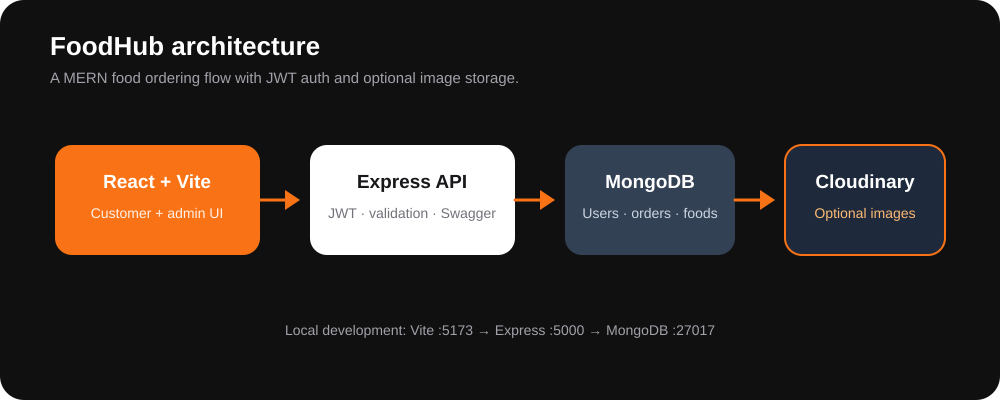
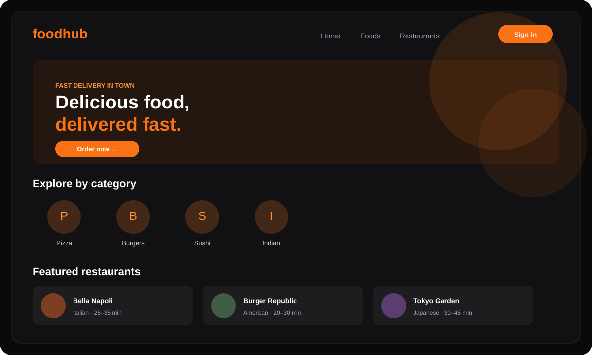

# FoodHub — MERN Food Ordering Platform

[](https://github.com/kirantej5/FoodHub/actions/workflows/ci.yml)
[](client/)
[](server/)
[](server/)
[](LICENSE)


FoodHub is a full-stack food-ordering platform built with MongoDB, Express, React, and Node.js. Customers can discover restaurants, build a persistent cart, checkout, and track orders. Administrators can manage users, food, restaurants, and order status.



## Features

### Customer

- JWT authentication and registration
- Featured food and restaurant discovery
- Restaurant menus and food detail pages
- Persistent Zustand shopping cart
- Checkout, coupon validation, and order history
- Order status timeline and profile management

### Admin

- Dashboard statistics
- User management
- Food CRUD with image upload support
- Restaurant/category assignment for menu items
- Order status management
- Swagger API documentation

## Technology

- **Frontend:** React 19, Vite, React Router, Zustand, Tailwind CSS, Axios
- **Backend:** Node.js, Express, Mongoose, Express Validator
- **Database:** MongoDB
- **Authentication:** JWT and bcryptjs
- **Images:** Multer with optional Cloudinary storage

## Project structure

```text
FoodHub/
├── client/          # React/Vite frontend
│   ├── src/api/     # Axios API clients
│   ├── src/components/
│   ├── src/pages/
│   └── src/store/   # Zustand stores
├── server/          # Express/Mongoose API
│   ├── config/      # Database and Swagger configuration
│   ├── controllers/
│   ├── models/
│   ├── routes/
│   ├── seed/
│   └── tests/
├── docs/            # Screenshots and architecture documentation
└── how to run.txt  # Plain-text local setup guide
```

## Installation and setup

### Prerequisites

- Node.js 20+
- MongoDB running locally or a MongoDB connection string

### Install

```bash
git clone https://github.com/kirantej5/FoodHub.git
cd FoodHub
npm install
npm run install:all
```

Copy the environment examples:

```bash
cp server/.env.example server/.env
cp client/.env.example client/.env
```

Update the values in both files, especially `MONGODB_URI`, `JWT_SECRET`, and `VITE_API_URL`.

Seed local demo data and start both applications:

```bash
npm run seed
npm run dev
```

- Frontend: <http://localhost:5173>
- API: <http://localhost:5000>
- Health check: <http://localhost:5000/api/health>
- Swagger: <http://localhost:5000/api/docs>

## Demo credentials

The seed command creates a **disposable local** admin account using `ADMIN_EMAIL` and `ADMIN_PASSWORD` from `server/.env`.

Default example values:

```text
Email:    admin@foodhub.com
Password: Admin@123456
```

Change these values before using non-local data.

## Environment variables

| File | Variable | Purpose | Example |
|---|---|---|---|
| `server/.env` | `MONGODB_URI` | MongoDB connection | `mongodb://127.0.0.1:27017/foodhub` |
| `server/.env` | `JWT_SECRET` | Token signing secret | long random value |
| `server/.env` | `ADMIN_EMAIL` | Seeded admin email | `admin@foodhub.com` |
| `server/.env` | `ADMIN_PASSWORD` | Seeded admin password | local-only value |
| `server/.env` | `CLIENT_URL` | CORS origin | `http://localhost:5173` |
| `client/.env` | `VITE_API_URL` | API base URL | `http://localhost:5000/api` |

Never commit `.env` files or production credentials. The committed example files contain development placeholders only.

## Screenshots and demo

| FoodHub experience | Architecture |
| :---: | :---: |
|  |  |

The repository also includes [`docs/screenshots/hero.jpg`](docs/screenshots/hero.jpg). The preview illustrates the intended customer browsing experience; capture authenticated menu, cart, checkout, order tracking, and admin screens after starting the seeded app locally.

## Testing and checks

Backend tests:

```bash
cd server
npm test
```

Frontend build and lint:

```bash
cd client
npm run build
npm run lint
```

The GitHub Actions workflow runs backend tests and a production frontend build.

## License

MIT. See [`LICENSE`](LICENSE).
